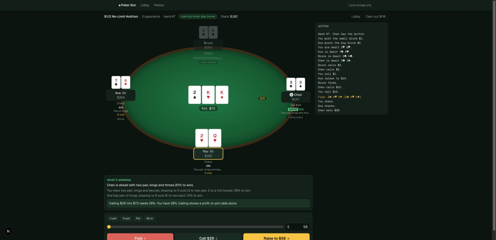
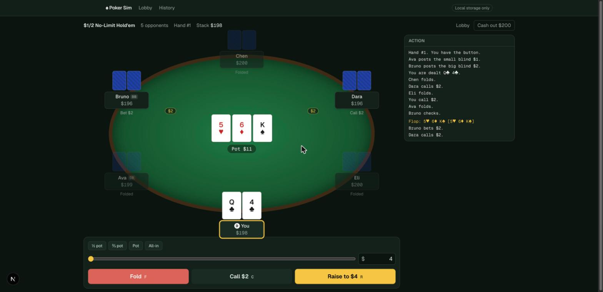
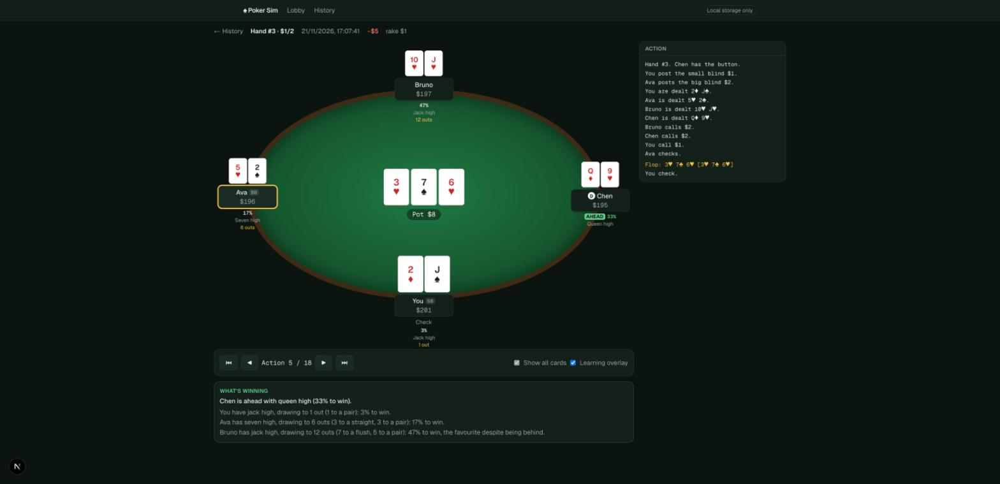
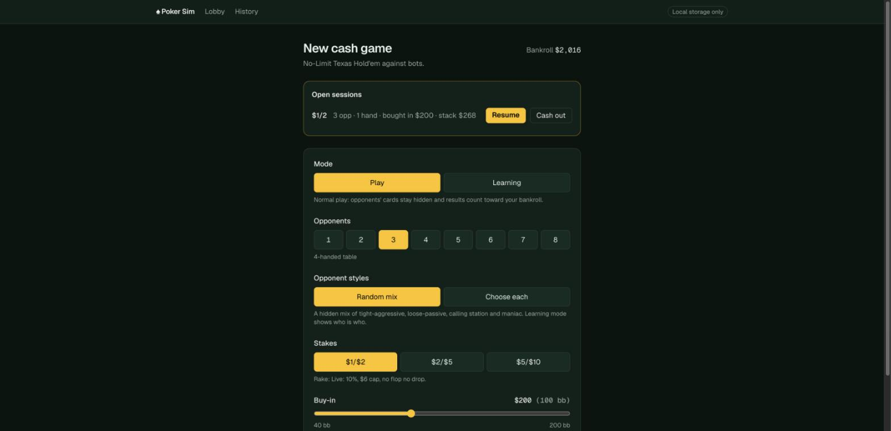

# Poker Sim

A No-Limit Texas Hold'em cash game simulator for learning two things:

1. **Hand reading.** A learning mode shows every hand face up and explains, street by street, who is winning, with what, and what the players behind need to catch up.
2. **Bankroll management.** Set a bankroll, pick stakes and a rake structure, and see how results, variance and rake decide which stake you should be playing.

You play one seat against 1 to 8 bots (default 3). Every hand is stored as an event log, so it can be replayed and analysed later.



| Playing a hand | Hand replayer with the learning overlay | Lobby |
|---|---|---|
|  |  |  |

## Status

Phase 5 of 7 is complete. The game is playable against bots, every hand is saved and replayable, and sessions resume after a refresh. Without a database the app saves to the browser; with Neon connected it saves through the passphrase-protected API.

| Phase | What it delivers | Status |
|---|---|---|
| 1. Engine | Rules, betting, side pots, rake, hand evaluator, equity | ✅ Done |
| 2. Table UI | Lobby, table, action controls, rebuys, phone layout | ✅ Done |
| 3. Bots | Four opponent styles, bot mix on the setup form | ✅ Done |
| 4. Persistence | Hands saved and replayable, resume after refresh, passphrase-protected API, Neon Postgres | ✅ Done |
| 5. Learning mode | Face-up cards, win % per player, outs, plain-English explanations | ✅ Done |
| 6. Bankroll | Ledger, buy-ins and cash-outs, win rate before and after rake, stake guidance | Next |
| 7. Extras | Variance simulator, decision review, fast-forward after folding | Planned |

Task-level progress and every deviation from the plan are in [`PROGRESS.md`](PROGRESS.md). The full design is in [`PLAN.md`](PLAN.md).

## What works today

- **Setup.** Choose 1 to 8 opponents, $1/$2, $2/$5 or $5/$10 stakes, a buy-in of 40 to 200 big blinds, and either a random mix of opponent styles or a style for each seat.
- **Play.** Full No-Limit Hold'em: blinds and button rotation, heads-up rules, minimum raises, all-ins with side pots, split pots, and live-style rake (10% capped at $6, no flop no drop).
- **Controls.** Fold, check/call and bet/raise with a slider, a dollar box and quick sizes (half pot, two-thirds pot, pot, all-in). Keyboard shortcuts F, C and R.
- **Between hands.** The hand result and rake, top-ups, and a rebuy prompt if you bust.
- **Bankroll.** A starting bankroll on first run. Buy-ins, rebuys and top-ups come out of it; cashing out puts your stack back. You cannot buy in for more than you have.
- **Sessions.** Every completed hand is saved. A refresh resumes at the next hand (a hand interrupted mid-way is void and your stack returns to what it was before it). Open sessions are listed in the lobby with Resume and Cash out.
- **History.** Every hand with position, cards, board and result, and a replayer that steps through the action forwards and back, with an option to show every player's cards.
- **Guest play.** Anyone without the passphrase can choose "Play as guest" on the unlock screen: play money, no bankroll, hands kept in their own browser. Guests never reach the protected API or your data.
- **Learning mode.** Choose Learning in the lobby for a play-money session where every hand is face up. Each seat shows its chance of winning, what it holds and its outs; the leader is badged; a panel explains who is ahead, what the players behind need, and your pot odds against your equity when you face a bet. Folded hands stay visible, dimmed. The same overlay is available on any hand in the replayer. Learning hands never touch your bankroll and are excluded from stats.
- **Opponents.**

  | Style | Plays like |
  |---|---|
  | Tight-aggressive | Plays few hands and bets them hard |
  | Loose-passive | Limps and calls a lot, rarely raises |
  | Calling station | Calls almost anything, hates folding |
  | Maniac | Raises and bluffs relentlessly |

  Bots see only what a real player in their seat could see.

## Stack

| Layer | Choice |
|---|---|
| App | Next.js 16 (App Router), React 19, TypeScript (strict) |
| Styling | Tailwind CSS 4 |
| Tests | Vitest |
| Hosting | Vercel (pushes to `main` deploy to production) |
| Analytics | Vercel Web Analytics (`@vercel/analytics`), page views only; session ids in URLs are collapsed to `[id]` |
| Database | Neon Postgres from the Vercel Marketplace, Drizzle ORM, Neon HTTP driver; falls back to browser storage when not connected |
| Validation | zod on every API request body |
| Charts (Phase 6) | Recharts |
| Equity in the UI | Web Worker: exact enumeration from the flop on, a seeded 20,000-runout Monte Carlo preflop |

The game engine is plain TypeScript with no React, network or randomness of its own. It is a reducer, `(state, action) -> { state, events }`, driven by a seeded random number generator. The same session seed always deals the same cards, and any hand can be rebuilt exactly from its starting state and the actions taken. An ESLint rule stops the engine and the other pure modules from importing UI code or calling `Math.random` or `Date.now`.

All money is integer cents everywhere and is only formatted as dollars in the UI.

## Running locally

Needs Node 20+ and pnpm.

```bash
pnpm install
pnpm dev          # http://localhost:3000
```

| Command | What it does |
|---|---|
| `pnpm test` | Unit and simulation tests (Vitest) |
| `pnpm typecheck` | Generates Next.js route types, then `tsc --noEmit` |
| `pnpm lint` | ESLint, including the purity rule for the engine and bots |
| `pnpm build` | Production build |

No environment variables are needed to run locally. Analytics sends nothing in development.

| Database command | What it does |
|---|---|
| `pnpm db:generate` | Writes a SQL migration to `drizzle/` from the schema (no database needed) |
| `pnpm db:migrate` | Applies migrations to `DATABASE_URL` |

## Environment variables

Listed in [`.env.example`](.env.example). Local values go in `.env.local`, which is git-ignored. Neither is needed to run locally.

| Variable | Purpose | If unset |
|---|---|---|
| `DATABASE_URL` | Neon Postgres connection string | The app saves everything in the browser's localStorage and shows a "Local storage only" badge |
| `APP_PASSPHRASE` | Passphrase for the unlock screen that protects the API | Skipped in development; API routes refuse to run in production |

The passphrase is exchanged at `/unlock` for an `httpOnly` cookie and is never stored in the browser. Visitors without it can play as guests (play money, browser-only storage).

## Connecting the database

1. In the Vercel project, open **Storage**, add **Neon** from the Marketplace and connect it to the project. This sets `DATABASE_URL`.
2. Put the connection string in `.env.local` as `DATABASE_URL`. Vercel keeps production variables as sensitive, so `vercel env pull` writes them as empty strings; copy the pooled connection string from the Neon console (**Connect**) instead. Check which Neon branch or database it points at before the next step.
3. Create the tables: `pnpm db:migrate`. This applies the SQL in `drizzle/` to `DATABASE_URL` (the Drizzle config reads `.env.local` itself).
4. Redeploy. The "Local storage only" badge disappears and the app asks for the passphrase.

Hands played in browser-storage mode stay in that browser; they are not copied to the database.

Once `.env.local` holds the production `DATABASE_URL`, `pnpm dev` reads and writes production data. To run locally on browser storage instead, start it with `DATABASE_URL= pnpm dev`.

`pnpm db:generate` creates a new migration after a schema change and needs no database.

## Project layout

```
src/
  engine/      Pure poker engine: cards, RNG, evaluator, betting reducer, pots, rake, equity, outs
  bots/        Pure bot logic: Chen formula, player view, style profiles, decisions
  analysis/    Pure learning-mode explanations (made hands, outs, leader, pot odds)
  workers/     Equity Web Worker and its typed client
  bankroll/    Stakes and rake presets (stats, guidance and variance arrive in Phases 6 and 7)
  data/        Shared types and zod schemas, Repository (HTTP and localStorage), retry queue, hand summaries
  db/          Drizzle schema and Neon client
  server/      API auth, route wrapper and database service
  game/        Table session reducer, useTable and useLearning hooks, resume state, replayer, view model, action log text
  components/  Lobby, table, controls, history, replayer, unlock
  lib/         Money formatting
  app/         Routes: lobby, /play/[sessionId], /history, /history/[handId], /unlock, and /api/*
drizzle/       Generated SQL migrations
```

## Tests

100 tests across the engine, bots, table session, data layer and learning explanations, including:

- **Chip conservation** over 2,000 random hands of 2 to 9 players.
- **Exact pot outcomes** for side pots with three all-ins of different sizes, and for split pots with an odd chip.
- **Rule enforcement.** Minimum raises, incomplete all-in raises, the big blind option, uncalled bets, and the rake cap with "no flop, no drop".
- **Evaluator accuracy.** The fast hand evaluator agrees with a naive reference on 20,000 random hands.
- **Deterministic replay.** Any hand rebuilds identically from its seed and actions.
- **Bot behaviour.** A 5,000-hand bot simulation confirms the four styles play differently, with every action legal.
- **Learning explanations.** Leaders, outs grouped by what they make, drawing dead, splits, and pot odds on fixed boards.
- **Data layer.** Bankroll rules (no buy-in beyond the balance, idempotent saves and cash-outs), hand summaries (net, rake share, VPIP, PFR, position), the offline retry queue, passphrase checks, resume after refresh, and the replayer reproducing stored hands.
